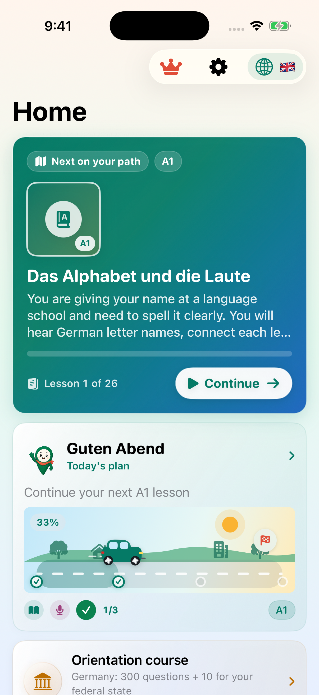
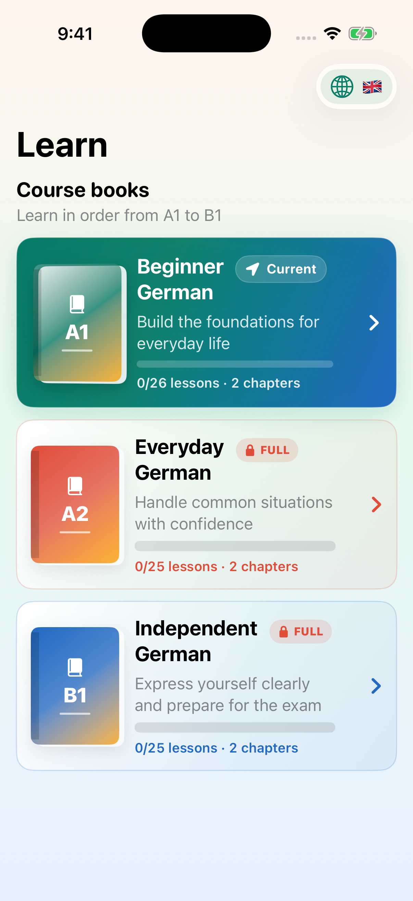
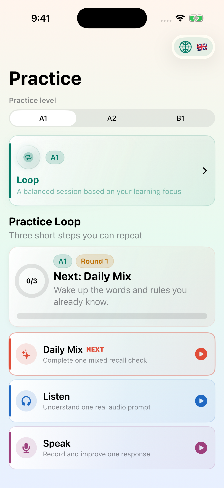

# Deutsch B1 Coach

Offline-first German learning for adult learners working from A1 to B1: lessons, spaced repetition, speaking practice, and progress in a native iOS app.

Swift · SwiftUI · SwiftData · Swift Concurrency · Speech · StoreKit 2 · Swift Charts · on-device neural audio

[](https://github.com/fayselomerahmed/deutsch-b1-coach-ios/actions/workflows/build.yml)

<p>
  
  
  
</p>

Genuine iPhone simulator captures using bundled curriculum and fresh local state. [Reproducible capture workflow](https://github.com/fayselomerahmed/deutsch-b1-coach-ios/actions/runs/39063739835).

## The problem

Language study often spreads vocabulary, grammar, speaking, and exam practice across separate tools. This project brings them into one learning path while keeping the core curriculum and learner progress available without a server connection.

## Implemented

- Placement, guided lessons, grammar practice, everyday conversation missions, and a timed B1-style practice exam.
- 702 bundled vocabulary entries across A1, A2, and B1, with examples, audio, and SM-2 review scheduling.
- Speaking and writing exercises with local response evaluation; Apple Speech provides recognition where supported.
- SwiftData-backed progress, learning activity, mastery, streaks, and XP, visualized with Swift Charts.
- Teaching-language explanations, study reminders, Dynamic Type, VoiceOver labels, and dark mode.
- StoreKit 2 subscription/restoration integration and optional managed-access entitlements.

## Engineering highlights

**Content updates without resetting progress.** [ContentLoader](DeutschB1Coach/Services/ContentLoader.swift) synchronizes stable curriculum IDs separately from learner records. [CurriculumFactory](DeutschB1Coach/Services/CurriculumFactory.swift) expands source packs into practice; scheduling and response evaluation are independent of the UI.

**Reuse work until content changes.** A [revision-scoped cache](DeutschB1Coach/Services/ContentRevisionCache.swift) reuses successful source decodes and generated lesson/quiz arrays. Imports, rollback, and live updates invalidate the cache; failed reads remain retryable. This reduces repeated work, with an explicit trade-off of retaining immutable course values in memory.

**On-device speech, with an explicit size trade-off.** Common clips are bundled; new German audio runs through a Swift/Objective-C++ bridge to sherpa-onnx. A serial background queue, validated temporary files, and a bounded cache keep inference and file management outside view code. This removes a paid speech-service dependency but adds model size and native-runtime complexity.

**Optional services, not a startup dependency.** The companion [Curriculum Studio](https://github.com/fayselomerahmed/deutsch-b1-coach-studio) publishes versioned, hash-checked content. Verified content is retained locally; remote services require explicit HTTPS configuration and are disabled in a fresh checkout.

**Recoverable storage and bounded background work.** [Startup](DeutschB1Coach/App/ModelContainerStartup.swift) offers retry if persistent storage cannot open, without deleting learner data or silently switching to temporary storage. Managed-access refreshes use a bounded cadence and retry backoff rather than continuous polling.

[Read the engineering case study](docs/CASE_STUDY.md) for the data, audio, and testing decisions.

## Verified build and tests

The [verified CI run](https://github.com/fayselomerahmed/deutsch-b1-coach-ios/actions/runs/39072623138) at `1e0f92e` passed a Release iOS simulator build, **94 iOS XCTest cases**, and **18 host-runnable core tests** on 2026-10-18 (Europe/Berlin). Coverage includes curriculum integrity, review scheduling, free-response evaluation, speech scoring, remote configuration, startup recovery, managed-access refresh policy, and revision-aware cache reuse/invalidation. The core package reuses a subset of the iOS tests; its count is not additive distinct-test coverage.

```bash
swift test
```

The full iOS suite runs through the shared `DeutschB1Coach` Xcode scheme. [CI configuration](.github/workflows/build.yml) documents the exact build and test commands.

Documentation-only pushes skip the app rebuild; pull requests and manual runs still execute all build checks. Secret scans remain active for every push.

## Run locally

Use Xcode 26.4 (the verified CI toolchain), Git LFS, and XcodeGen. The app's deployment target is iOS 17. Git LFS is required for the speech model and native binaries.

```bash
git clone https://github.com/fayselomerahmed/deutsch-b1-coach-ios.git
cd deutsch-b1-coach-ios
git lfs install
git lfs pull
xcodegen generate
open DeutschB1Coach.xcodeproj
```

Select the `DeutschB1Coach` scheme and an installed iPhone simulator. Physical-device builds require your own signing team. The bundled course and neural audio do not require API keys; optional studio setup is documented in [Live Content](DeutschB1Coach/Docs/LiveContentSetup.md).

## Release scope and credits

This is a portfolio development project with verified builds and automated tests, not an App Store release claim. Physical-device validation, teacher review, production services, StoreKit configuration, and distribution requirements remain explicit [release gates](PRODUCTION_READINESS.md). Practice exams are not affiliated with Goethe-Institut, telc, or another examination provider.

[Architecture](DeutschB1Coach/Docs/Architecture.md) · [Teacher-review protocol](DeutschB1Coach/Docs/TeacherReviewProtocol.md) · [Privacy](PRIVACY.md) · [Support](SUPPORT.md) · [Third-party notices](DeutschB1Coach/Docs/ThirdPartyNotices.md)

The audio integration uses sherpa-onnx, ONNX Runtime, and the Thorsten voice model. Existing model, runtime, and audio-generation notices and attribution remain part of the repository.
